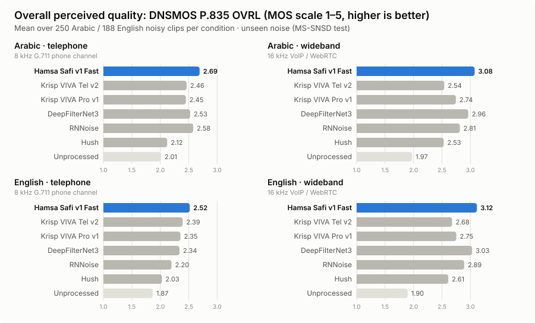

# Hamsa Safi v1 Fast

**Real-time noise suppression built for Arabic voice.** `hamsa-safi-v1-fast` is a streaming speech-enhancement model from
Hamsa AI for voice agents, contact centres and VoIP. It processes 10 ms frames on a single CPU core. In our benchmark it delivers
**higher perceived quality than Krisp, Hush and RNNoise on Arabic speech in every condition we tested**: phone lines and
wideband VoIP, synthetic mixtures and real recordings. It also gives **the highest perceived quality (DNSMOS) on Arabic phone audio of any system tested**,
including DeepFilterNet3, and is best or tied-best on every metric on synthetic Arabic wideband.

### ▶ [Listen to the samples and explore the interactive benchmark](https://hamsa-ai.github.io/hamsa-safi-v1-fast/)

<p align="center"></p>

## Highlights

| | |
|---|---|
| **Arabic wideband (16 kHz)** | Best or tied-best on **all six metrics** (PESQ, STOI, SI-SDR, DNSMOS SIG/BAK/OVRL) against every system tested. **+4.2 dB SI-SDR** over Krisp Pro v1, rated higher than Krisp Tel v2 on **94%** of clips. |
| **Arabic telephone (8 kHz G.711)** | Highest perceived quality of any system: **+0.23 DNSMOS OVRL over Krisp Tel v2**, preferred on **85%** of calls. Matches Krisp on SI-SDR, and beats every open model (DeepFilterNet3, RNNoise, Hush) by +0.34 PESQ or more. |
| **English** | Highest DNSMOS in both conditions. On wideband it beats or ties both Krisp models on every metric. |
| **Real-time** | 10 ms frames, ~30 ms delay, 2.0 ms CPU per 10 ms frame on one vCPU (RTF 0.20). |

## Why a new benchmark

Most published speech-enhancement results use English VoiceBank-DEMAND, which overlaps with common training corpora
(VCTK, DEMAND) and says little about Arabic. To measure fairly, we built a test set **Safi never saw**:

- **Speech:** FLEURS test split. Egyptian Arabic, 250 utterances. US English, 188 utterances.
- **Noise:** MS-SNSD `noise_test`: babble, neighbour talking, airport announcements, air conditioner, typing, door slams,
  copy machine, vacuum cleaner, eating. Mixed at −5 to +15 dB SNR.
- **Two channels:** 16 kHz wideband (WebRTC / VoIP) and a simulated phone line (300–3400 Hz, 8 kHz, G.711 μ-law).
- **Same conditions for every system:** real-time streaming at 10 ms frames, full suppression strength, fresh session per
  clip, and each system's delay compensated before scoring. DeepFilterNet3 ran offline, which favours it.

## Results

Means over all clips. **Bold** = best processed system per column.

#### Arabic · telephone  
<sub>8 kHz G.711 phone channel · n = 250 clips</sub>

| System | PESQ | STOI | SI-SDR (dB) | DNSMOS SIG | DNSMOS BAK | DNSMOS OVRL |
|---|---:|---:|---:|---:|---:|---:|
| **Hamsa Safi v1 Fast** | 2.53 | 0.822 | 10.85 | **2.96** | **3.98** | **2.69** |
| Krisp VIVA Tel v2 | **2.60** | **0.851** | **10.87** | 2.72 | 3.89 | 2.46 |
| Krisp VIVA Pro v1 | 2.53 | 0.844 | 8.59 | 2.71 | 3.88 | 2.45 |
| DeepFilterNet3 | 2.19 | 0.794 | 7.53 | 2.83 | 3.86 | 2.53 |
| RNNoise | 2.12 | 0.792 | 7.72 | 2.90 | 3.80 | 2.58 |
| Hush | 1.85 | 0.690 | 1.28 | 2.49 | 3.58 | 2.12 |
| Unprocessed | 1.99 | 0.792 | 5.73 | 2.69 | 2.28 | 2.01 |

#### Arabic · wideband  
<sub>16 kHz VoIP / WebRTC · n = 250 clips</sub>

| System | PESQ | STOI | SI-SDR (dB) | DNSMOS SIG | DNSMOS BAK | DNSMOS OVRL |
|---|---:|---:|---:|---:|---:|---:|
| **Hamsa Safi v1 Fast** | **1.97** | **0.878** | **12.09** | **3.35** | **4.02** | **3.08** |
| Krisp VIVA Tel v2 | 1.81 | 0.783 | 6.70 | 2.81 | 3.88 | 2.54 |
| Krisp VIVA Pro v1 | 1.91 | 0.872 | 7.92 | 3.01 | 3.94 | 2.74 |
| DeepFilterNet3 | 1.92 | 0.857 | 10.27 | 3.28 | 3.91 | 2.96 |
| RNNoise | 1.60 | 0.856 | 8.98 | 3.18 | 3.78 | 2.81 |
| Hush | 1.56 | 0.793 | 4.73 | 3.05 | 3.36 | 2.53 |
| Unprocessed | 1.33 | 0.794 | 4.21 | 2.69 | 2.07 | 1.97 |

#### English · telephone  
<sub>8 kHz G.711 phone channel · n = 188 clips</sub>

| System | PESQ | STOI | SI-SDR (dB) | DNSMOS SIG | DNSMOS BAK | DNSMOS OVRL |
|---|---:|---:|---:|---:|---:|---:|
| **Hamsa Safi v1 Fast** | 1.98 | 0.648 | 4.88 | **2.78** | **4.05** | **2.52** |
| Krisp VIVA Tel v2 | **2.06** | **0.717** | **6.13** | 2.66 | 3.94 | 2.39 |
| Krisp VIVA Pro v1 | 1.96 | 0.706 | 4.97 | 2.62 | 3.92 | 2.35 |
| DeepFilterNet3 | 1.76 | 0.613 | 2.10 | 2.62 | 3.96 | 2.34 |
| RNNoise | 1.50 | 0.468 | -4.54 | 2.49 | 3.88 | 2.20 |
| Hush | 1.64 | 0.570 | -0.73 | 2.36 | 3.70 | 2.03 |
| Unprocessed | 2.00 | 0.709 | 3.96 | 2.57 | 2.05 | 1.87 |

#### English · wideband  
<sub>16 kHz VoIP / WebRTC · n = 188 clips</sub>

| System | PESQ | STOI | SI-SDR (dB) | DNSMOS SIG | DNSMOS BAK | DNSMOS OVRL |
|---|---:|---:|---:|---:|---:|---:|
| **Hamsa Safi v1 Fast** | 1.62 | 0.737 | **8.69** | **3.37** | **4.09** | **3.12** |
| Krisp VIVA Tel v2 | 1.54 | 0.703 | 6.34 | 2.94 | 3.95 | 2.68 |
| Krisp VIVA Pro v1 | 1.56 | 0.737 | 7.12 | 3.01 | 3.99 | 2.75 |
| DeepFilterNet3 | **1.63** | **0.740** | 8.30 | 3.33 | 4.00 | 3.03 |
| RNNoise | 1.44 | 0.701 | 5.45 | 3.20 | 3.92 | 2.89 |
| Hush | 1.43 | 0.678 | 3.56 | 3.08 | 3.52 | 2.61 |
| Unprocessed | 1.34 | 0.708 | 4.04 | 2.63 | 1.96 | 1.90 |


Per-clip scores, SNR and noise-type breakdowns, and paired-bootstrap 95% intervals for every Safi-vs-system gap are in
[`results/`](results/). On phone audio, Krisp Tel v2 keeps a small lead on the reference-based PESQ/STOI metrics, mostly on
clips where the noise is other people talking. Safi leads on every perceptual (DNSMOS) metric.

## Real-world recordings

Synthetic mixtures are controlled; real calls are not. We also ran every system on **100 genuinely noisy Arabic recordings** from
Mozilla Common Voice (CC0): crowd recordings made on people's own laptops and phones, with real rooms, fans, traffic and echo,
and no added noise. These are the noisiest 100 of 1,500 randomly scanned clips, one per speaker. They're scored with DNSMOS P.835, since no clean
reference exists, both as recorded and through a G.711 phone channel.

| System | DNSMOS OVRL (16 kHz) | DNSMOS OVRL (phone channel) |
|---|---:|---:|
| **Hamsa Safi v1 Fast** | 2.89 | **2.66** |
| Krisp VIVA Tel v2 | 2.78 | 2.58 |
| Krisp VIVA Pro v1 | 2.76 | 2.59 |
| DeepFilterNet3 | **2.93** | 2.59 |
| RNNoise | 2.75 | 2.22 |
| Hush | 2.67 | 2.11 |
| Original recording | 2.55 | 2.55 |

Safi is rated higher than Krisp Tel v2 on **68%** of real recordings (16 kHz) and **71%** over the phone channel.
Listen to examples on the [interactive page](https://hamsa-ai.github.io/hamsa-safi-v1-fast/).

## Deployment

| System | Streaming | CPU ms per 10 ms frame | Delay |
|---|---|---:|---:|
| **Hamsa Safi v1 Fast** | 10 ms frames | 2.01 | ~30 ms |
| Krisp VIVA Tel v2 | 10 ms frames | 0.94 | ~25 ms |
| Krisp VIVA Pro v1 | 10 ms frames | 1.02 | ~28 ms |
| Hush | 10 ms frames | 0.95 | ~10 ms |
| RNNoise | 10 ms frames | 0.25 | ~20 ms |
| DeepFilterNet3 | offline (Python) | – | 40 ms nominal |

Single thread, AMD EPYC 7R32. Delay measured by cross-correlation on the benchmark.

## Systems compared

| System | Version / settings |
|---|---|
| Hamsa Safi v1 Fast | streaming ONNX runtime, full strength |
| Krisp | SDK 1.4.0, `krisp-viva-tel-v2` and `krisp-viva-pro-v1`, 16 kHz, NS level 100 |
| DeepFilterNet3 | official checkpoint, `deepfilternet` 0.5.6, 48 kHz |
| RNNoise | reference model via `pyrnnoise`, 48 kHz |
| Hush | `weya-ai/hush` (Apache-2.0), stateful ONNX streaming runtime, full strength |

## Repository layout

```
docs/                 GitHub Pages site (interactive charts + A/B listening)
  samples/<clip>/     clean, noisy and each system's output at one common gain per clip (true output level)
  assets/             overview chart and data.json
results/
  summary.csv         per condition × system means
  per_clip.csv        every score for every clip
  by_noise.csv        breakdown by noise type
  by_snr.csv          breakdown by input SNR
  significance.csv    paired-bootstrap 95% CIs and per-clip win rates (Safi vs each system)
  per_clip_real.csv   DNSMOS scores on the real Common Voice recordings
  testset_*_manifest  exact source files (FLEURS + MS-SNSD noise + SNR; Common Voice clip ids) for every clip
```

## Access

Hamsa Safi is available through the Hamsa AI platform. For SDK or on-premise licensing, contact Hamsa AI.

## Attribution and license

Benchmark audio is derived from [FLEURS](https://huggingface.co/datasets/google/fleurs) (CC BY 4.0, Google) and
[MS-SNSD](https://github.com/microsoft/MS-SNSD) (MIT, Microsoft). Sample clips and result files in this repository are
released under CC BY 4.0. Krisp, DeepFilterNet, RNNoise and Hush belong to their respective owners and were evaluated as
published, with the settings above.

© 2026 Hamsa AI
